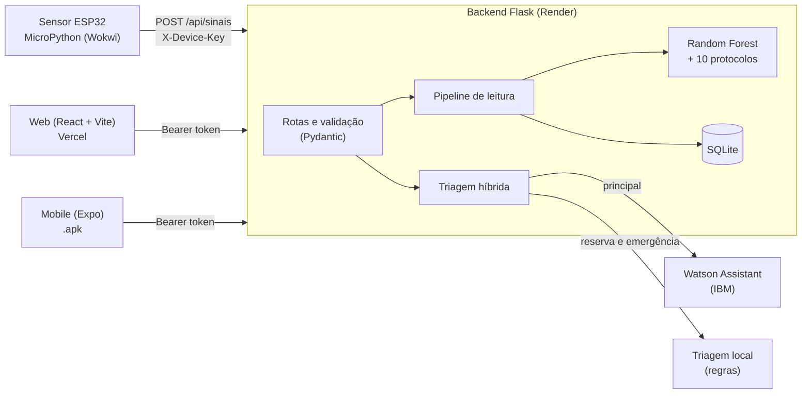

# CardioIA — Backend Integrador (Fase 7)

API em Flask que conecta o sensor (MicroPython), o modelo preditivo (Random Forest da Fase 6), o motor de protocolos clínicos, a triagem conversacional (Watson Assistant da Fase 5, com o mesmo fluxo portado para regras como reserva) e as interfaces Web e Mobile.

> Protótipo acadêmico com dados sintéticos. Não substitui avaliação médica.

Quem vai integrar web, mobile ou sensor deve começar pelo [`GUIA_INTEGRACAO.md`](GUIA_INTEGRACAO.md).

## Arquitetura



Fluxo do sinal: o sensor envia FC, temperatura e (opcionalmente) SpO2. O backend completa as 10 variáveis do modelo, calcula a probabilidade de crise, classifica o risco, avalia os protocolos, grava a leitura e devolve a recomendação. A web e o app consultam a última leitura por polling.

## Estrutura

```text
backend/
├── app/
│   ├── __init__.py              Fábrica da aplicação, CORS, tratamento de erros
│   ├── config.py                Variáveis de ambiente e leitura do .env
│   ├── ml/
│   │   ├── schemas.py           DadosPaciente, LeituraSensor, ParametrosOperacionais
│   │   ├── treino.py            Base sintética e treino do Random Forest
│   │   ├── modelo.py            Carga do .pkl (com cache) e inferência
│   │   ├── protocolos.py        Faixas de risco e os 10 protocolos clínicos
│   │   └── recomendacao.py      Probabilidade, classificação, fatores e recomendação
│   ├── routes/                  auth, clinico (sinais, risco, pacientes, operação) e chat
│   └── services/
│       ├── auth.py              Tokens assinados e chave do dispositivo
│       ├── store.py             SQLite (pacientes, leituras, parâmetros operacionais)
│       ├── pipeline.py          Monta as 10 variáveis, analisa e grava; dados de demonstração
│       ├── triagem.py           Triagem local (máquina de estados do fluxo da Fase 5)
│       ├── triagem_hibrida.py   Watson como principal, triagem local como reserva
│       └── watson.py            Cliente HTTP do Watson Assistant
├── tests/                       128 testes (pytest)
├── treinar_modelo.py            Gera o modelo_risco_cardiaco.pkl
├── testar_watson.py             Diagnóstico das credenciais do Watson
├── run.py                       Ponto de entrada
├── render.yaml                  Configuração do deploy
└── GUIA_INTEGRACAO.md           Guia para quem consome a API
```

## Executar localmente

```bash
cd backend
python -m venv .venv
source .venv/bin/activate
pip install -r requirements-dev.txt
cp .env.example .env
python treinar_modelo.py
python run.py
```

No Windows, ative o ambiente com `.venv\Scripts\activate`. O servidor sobe em `http://localhost:5000`. Se o `.pkl` não existir, o backend treina o modelo na primeira inicialização. Para rodar os testes: `pytest`.

## Variáveis de ambiente

Em produção são definidas no painel do Render. Localmente, vêm do `.env` (que não vai para o GitHub). Todas têm valor padrão, exceto as do Watson, que são opcionais.

| Variável | Para que serve | Padrão |
| :--- | :--- | :--- |
| `SECRET_KEY` | Assina os tokens de login | valor de desenvolvimento (troque em produção) |
| `DEVICE_API_KEY` | Chave do sensor, no header `X-Device-Key` | `cardioia-device-demo` |
| `MEDICO_SENHA`, `PACIENTE_SENHA` | Senhas dos usuários de demonstração | `medico123`, `paciente123` |
| `PACIENTE_PADRAO` | Paciente do usuário `paciente` e dos dados de exemplo | `p001` |
| `TOKEN_MAX_AGE` | Validade do token, em segundos | 43200 (12 h) |
| `CORS_ORIGINS` | Origens permitidas, separadas por vírgula | `*` |
| `SEED_DEMO` | Cria histórico de exemplo se o banco estiver vazio | `true` |
| `DB_PATH`, `MODEL_PATH` | Caminhos do SQLite e do modelo | `data/cardioia.db`, `modelo_risco_cardiaco.pkl` |
| `WATSON_API_KEY`, `WATSON_URL`, `WATSON_ASSISTANT_ID` | Credenciais do Watson (as três juntas ativam o Watson) | vazio |
| `WATSON_ENVIRONMENT_ID` | Só se a instância exigir assistente e ambiente separados | vazio |
| `WATSON_VERSION`, `WATSON_TIMEOUT` | Versão da API e tempo máximo por chamada (s) | `2021-06-14`, `6` |

## Autenticação

| Quem | Como | Credenciais de demonstração |
| :--- | :--- | :--- |
| Médico | `Authorization: Bearer <token>` | `medico` / `medico123` |
| Paciente | `Authorization: Bearer <token>` | `paciente` / `paciente123` |
| Sensor (ESP32) | Header `X-Device-Key` | valor de `DEVICE_API_KEY` |

Em produção, troque as senhas e as chaves pelas variáveis de ambiente.

## Endpoints

| Método | Rota | Acesso | Descrição |
| :--- | :--- | :--- | :--- |
| `GET` | `/health` | público | Healthcheck |
| `POST` | `/api/auth/login` | público | Corpo `{usuario, senha}`, retorna `token`, `perfil`, `paciente_id` |
| `GET` | `/api/auth/me` | login | Identidade do token |
| `POST` | `/api/sinais` | sensor | Recebe leitura, calcula risco e grava |
| `GET` | `/api/sinais/ultimo` | login | Última leitura e recomendação (`?paciente_id=`) |
| `GET` | `/api/sinais/historico` | login | Histórico (`?paciente_id=&limite=`) |
| `POST` | `/api/risco` | login | Risco a partir das 10 variáveis completas |
| `POST` | `/api/analise` | login | Reanálise da última leitura do paciente |
| `GET` | `/api/pacientes` | médico | Lista de pacientes com último status |
| `GET` / `PUT` | `/api/operacao` | médico | Parâmetros operacionais do hospital |
| `GET` | `/api/triagem/status` | público | Mostra se o Watson está configurado e ativo |
| `POST` | `/api/session` | público | Abre sessão de triagem |
| `POST` | `/api/message` | público | Corpo `{session_id, text}`, retorna `replies`, `options`, `emergencia`, `finalizado`, `origem` |
| `DELETE` | `/api/session/<id>` | público | Encerra a sessão |

Pacientes só acessam os próprios dados. Valores fora das faixas válidas retornam `422`. Exemplos completos de requisição e resposta estão no [`GUIA_INTEGRACAO.md`](GUIA_INTEGRACAO.md).

### Payload do sensor

```json
{
  "paciente_id": "p001",
  "fc_media": 130,
  "temperatura": 24,
  "spo2_media": 85,
  "pa_sistolica": 120,
  "dispositivo": "esp32-wokwi"
}
```

`spo2_media`, `pa_sistolica` e `dispositivo` são opcionais. Limites: `fc_media` 20–250, `temperatura` −20–60, `spo2_media` 0–100, `pa_sistolica` 40–300.

### Como o backend monta as 10 variáveis do modelo

| Variável | Origem |
| :--- | :--- |
| `fc_media`, `temperatura`, `spo2_media`, `pa_sistolica` | Sensor (SpO2 padrão 96 e PA padrão 125 se ausentes) |
| `idade_media` | Cadastro do paciente |
| `eventos_24h` | Episódios de risco ALTO do paciente nas últimas 24h (transições para ALTO, não leituras) |
| `carga_sistema`, `tempo_espera`, `disponibilidade_recursos`, `densidade_eventos` | Parâmetros operacionais (`/api/operacao`) |

O rótulo de treino exige pelo menos 2 de 6 critérios: carga > 80, espera > 60, SpO2 < 92, FC > 110, eventos > 4 e recursos < 40. Por isso uma leitura com só FC alta ou só SpO2 baixa fica abaixo de ALTO, e as duas juntas passam. `pa_sistolica`, `temperatura` e `idade_media` não influenciam o rótulo.

## Triagem: Watson com reserva local

Se `WATSON_API_KEY`, `WATSON_URL` e `WATSON_ASSISTANT_ID` estiverem definidos, o chat usa o Watson Assistant. Se não estiverem, ou se o Watson falhar, demorar mais de `WATSON_TIMEOUT` segundos ou ficar indisponível (3 falhas seguidas pausam o Watson por 60 s), o backend responde com a triagem local, sem mudar o contrato da API. Frases de emergência são sempre decididas localmente, antes do Watson. O campo `origem` da resposta indica quem respondeu.

Para validar as credenciais do Watson: `python testar_watson.py` (passo a passo no `GUIA_INTEGRACAO.md`).

## Deploy no Render

O `render.yaml` define build (`pip install` e treino do modelo), start com gunicorn (1 worker e 4 threads, porque a triagem guarda sessões em memória) e healthcheck. O Render só lê o `render.yaml` na raiz do repositório, então, num monorepo, copiem o arquivo para a raiz ou criem o serviço pelo painel com Root Directory `backend` (passo a passo no `GUIA_INTEGRACAO.md`). Defina `MEDICO_SENHA` e `PACIENTE_SENHA` no painel; `SECRET_KEY` e `DEVICE_API_KEY` são gerados automaticamente pelo `render.yaml`.

No plano gratuito o serviço hiberna sem uso e o disco é efêmero, então o SQLite é recriado com dados de demonstração a cada reinício (`SEED_DEMO=true`). Acorde o serviço com `GET /health` antes de qualquer demonstração.

## Testes e robustez

`pytest` roda 128 testes: fluxo sensor → risco → histórico, permissões por perfil, validação de entradas (corpos que não são objeto JSON, `NaN` e infinito, valores fora da faixa, `paciente_id` inválido, corpo gigante), token adulterado e expirado, CORS, erros inesperados em JSON, a triagem com frases de emergência variadas e a integração com o Watson (cliente HTTP real contra um servidor simulado, falhas, timeout e reserva local). Toda falha encontrada em auditoria virou teste de regressão.

Verificado em instalação limpa (Python 3.12, só `requirements.txt`): build com treino do modelo em cerca de 3 s, servidor saudável em 1 a 3 s, 120 leituras e 40 conversas concorrentes sem erro, e dados preservados após reiniciar.

## Limitações conhecidas

- A triagem local reconhece sintomas por palavras e padrões, sem NLP. Frases fora do vocabulário (por exemplo "quase desmaiei") caem no menu de opções em vez de acionar a emergência.
- Negações não são interpretadas: "não tenho dor no peito" aciona a emergência. É uma escolha deliberada pelo lado seguro.
- A integração com o Watson foi validada com uma instância real (endpoint antigo, sem `WATSON_ENVIRONMENT_ID`) e, nos testes automáticos, com um servidor simulado. Uma primeira mensagem que o Watson não reconhece (por exemplo "oi") é respondida com a boas-vindas e o menu da triagem local, e o texto do Watson passa por uma limpeza de pontuação (aspa solta, espaço antes de vírgula, vírgula sem espaço).
- As sessões do chat ficam em memória (limite de 2000, expiram em 1 hora) e se perdem ao reiniciar o servidor.
- O modelo reproduz uma regra sintética do treino. O resultado é um protótipo acadêmico, sem valor clínico.
