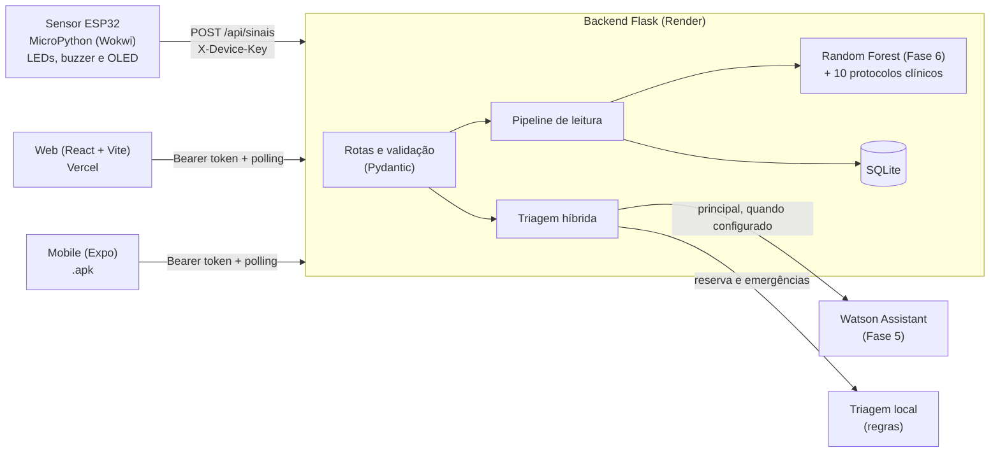
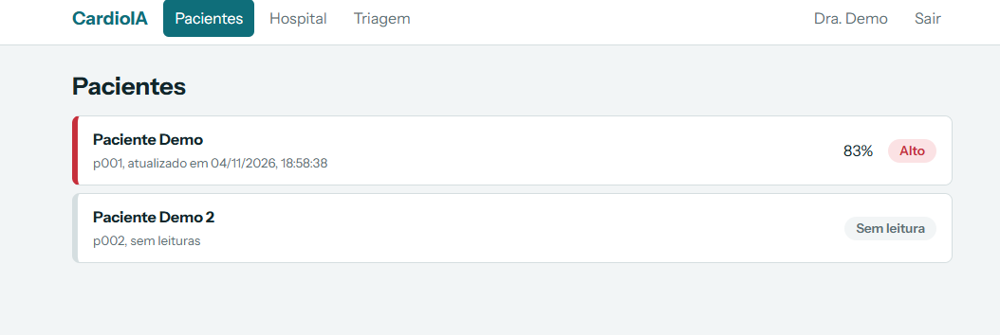
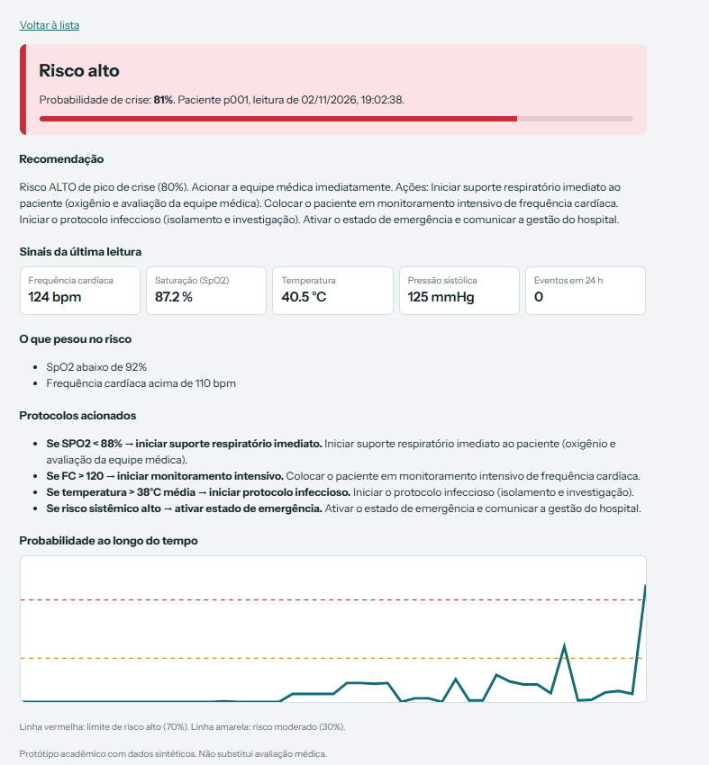
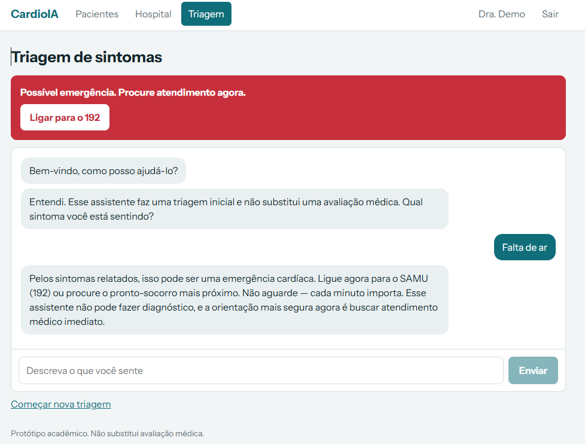
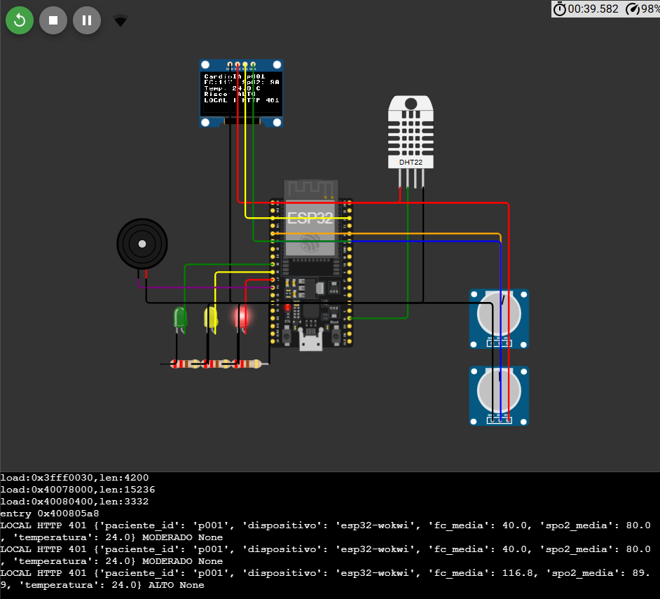
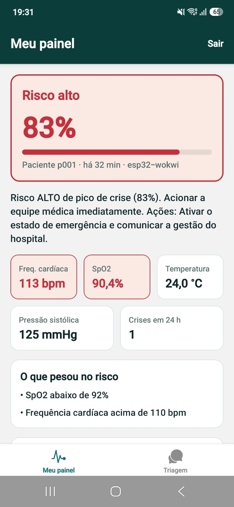

# FIAP - Faculdade de Informática e Administração Paulista

<p align="center">
<a href= "https://www.fiap.com.br/"></a>
</p>

<br>

# 🫀 CardioIA — Fase 7: Da Construção de Módulos à Solução Integrada

Plataforma que integra **sensor (IoT)**, **modelo preditivo**, **triagem conversacional**, **web** e **mobile** para monitorar o risco cardíaco de pacientes em tempo real e apoiar a gestão de crise hospitalar.

> Protótipo acadêmico com dados sintéticos. Não substitui avaliação médica.

---

## 🔗 Links da entrega

| Item | Link |
| :--- | :--- |
| 🌐 Web (Vercel) | https://fase-7-da-construcao-de-modulos-a-s.vercel.app |
| ⚙️ API (Render) | https://fase-7-da-construcao-de-modulos-a.onrender.com |
| 🔌 Sensor (Wokwi) | https://wokwi.com/projects/479615874964743169 |
| 📱 App Android (.apk) | https://expo.dev/accounts/vitor_eiji/projects/mobile/builds/2c736c36-318b-46a9-919f-7010bd50f3dd |
| 🎥 Vídeo de demonstração | https://youtu.be/ZMQOWeg5Zrc |
| 📄 Relatório (PDF) | [Relatório cardioIA](docs/Relatorio_CardioIA_Fase7.pdf) |

> ⏱️ A API roda no plano gratuito do Render e **hiberna sem uso**. A primeira chamada pode levar cerca de 1 minuto. Abra `/health` na URL da API antes de testar; web e app avisam "acordando o servidor" e tentam de novo sozinhos.

---

## 🧩 Visão geral



**Fluxo principal:** o sensor envia frequência cardíaca, temperatura e SpO2. O backend completa as 10 variáveis do modelo, calcula a probabilidade de crise, classifica o risco (BAIXO, MODERADO ou ALTO), aciona os protocolos, grava a leitura e devolve a recomendação. O sensor mostra o resultado em LEDs, buzzer e display, e a web e o app mostram a mesma leitura por *polling* a cada poucos segundos.

**Reaproveitamento das fases anteriores:**

| Fase | O que foi reaproveitado |
| :--- | :--- |
| Fase 5 | Fluxo de triagem do Watson Assistant (portado também para regras, como reserva) e o app Expo de chat |
| Fase 6 | Modelo Random Forest, as 10 variáveis de entrada e os 10 protocolos clínicos |

---

## 📋 Requisitos da Fase 7

| Requisito | Situação | Onde |
| :--- | :---: | :--- |
| Backend integrador em Python (modelo preditivo + conversacional) | ✅ | `backend/` |
| Web em React + Vite publicada na Vercel, com `vercel.json` | ✅ | `web/` |
| Mobile em Expo com build `.apk` (EAS) | ✅ | `mobile/` |
| Sensor em MicroPython no Wokwi com feedback (LED e OLED) | ✅ | `iot/` |
| Diagrama de arquitetura | ✅ | seção "Visão geral" |
| Relatório em PDF | ✅ | _a anexar_ |
| Vídeo de até 5 minutos | ✅ | _a anexar_ |
| Ir Além | ✅ | `IR_ALEM/` |

---

## 🗂️ Estrutura do repositório

```bash
📂 raiz
│
├── 📂 backend              API Flask: modelo, protocolos, autenticação, triagem
│   ├── 📂 app              ml/, routes/ e services/
│   ├── 📂 tests            134 testes (pytest)
│   ├── run.py
│   ├── treinar_modelo.py
│   ├── testar_watson.py
│   └── GUIA_INTEGRACAO.md  contrato da API para web, mobile e sensor
│
├── 📂 web                  React + Vite (Vercel)
├── 📂 mobile               Expo + React Native (EAS)
├── 📂 iot                  MicroPython para o Wokwi (ESP32)
├── 📂 IR_ALEM              material do "Ir Além"
├── 📂 docs                 referências (JSON da Action do Watson), prints
├── render.yaml             configuração do deploy do backend (Render)
└── README.md
```

---

## 🚀 Como avaliar rapidamente

1. Acorde a API abrindo `https://fase-7-da-construcao-de-modulos-a.onrender.com/health`.
2. Abra a web e entre como **médico** (usuário `medico`). A lista de pacientes e o painel de risco aparecem.
3. Abra o projeto do **Wokwi**, dê play e gire os potenciômetros: FC acima de 110 e SpO2 abaixo de 92 levam o risco a **ALTO** (LED vermelho, buzzer e OLED). Em até 3 segundos o painel da web e do app mostram a mesma leitura.
4. Entre como **paciente** (usuário `paciente`): o painel abre direto no próprio risco, sem a lista e sem a aba Hospital.
5. Na aba **Triagem**, escolha "Dor no peito": aparece o alerta de emergência com o botão para ligar 192.

> As senhas de demonstração são definidas nas variáveis de ambiente do Render e não ficam neste repositório. Elas constam no relatório entregue.

---

## 🛠️ Como rodar localmente

### Backend

```bash
cd backend
python -m venv .venv
source .venv/bin/activate        # Windows: .venv\Scripts\activate
pip install -r requirements-dev.txt
cp .env.example .env             # Windows: copy .env.example .env
python treinar_modelo.py
python run.py                    # http://localhost:5000
pytest                           # 134 testes
```

### Web

```bash
cd web
npm install
cp .env.example .env             # VITE_API_URL=https://...onrender.com
npm run dev
```

### Mobile

```bash
cd mobile
npm install
cp .env.example .env             # EXPO_PUBLIC_API_URL=https://...onrender.com
npx expo start                   # Expo Go ou emulador Android
eas build -p android --profile preview   # gera o .apk
```

### Sensor (Wokwi)

Crie um projeto **ESP32 com MicroPython**, copie os arquivos de `iot/` e, em `config.py`, preencha `API_URL` e `DEVICE_KEY` (valor de `DEVICE_API_KEY` do Render). O projeto pronto está no link do Wokwi acima. Detalhes em [`iot/README.md`](iot/README.md).

---

## 🔐 Variáveis de ambiente

| Onde | Variável | Para que serve |
| :--- | :--- | :--- |
| Render | `SECRET_KEY` | Assina os tokens de login |
| Render | `DEVICE_API_KEY` | Chave do sensor (`X-Device-Key`) |
| Render | `MEDICO_SENHA`, `PACIENTE_SENHA` | Senhas dos usuários de demonstração |
| Render | `WATSON_API_KEY`, `WATSON_URL`, `WATSON_ASSISTANT_ID` | Opcionais: ativam o Watson na triagem |
| Vercel | `VITE_API_URL` | URL da API |
| EAS / `.env` | `EXPO_PUBLIC_API_URL` | URL da API no app |

Nenhuma chave ou senha fica no repositório. A `DEVICE_API_KEY` nunca vai para a web nem para o app, só para o sensor.

---

## 🔌 API em resumo

| Método | Rota | Acesso |
| :--- | :--- | :--- |
| `GET` | `/health` | público |
| `POST` | `/api/auth/login` | público |
| `POST` | `/api/sinais` | sensor (`X-Device-Key`) |
| `GET` | `/api/sinais/ultimo`, `/api/sinais/historico` | login |
| `GET` | `/api/pacientes` | médico |
| `GET` / `PUT` | `/api/operacao` | médico |
| `POST` | `/api/session`, `/api/message` | público (triagem) |
| `GET` | `/api/triagem/status` | público |

Contrato completo, exemplos e erros em [`backend/GUIA_INTEGRACAO.md`](backend/GUIA_INTEGRACAO.md).

---

## 🧠 Decisões técnicas

- **Modelo:** Random Forest da Fase 6, treinado com dados sintéticos. O rótulo exige pelo menos 2 de 6 critérios (carga > 80, espera > 60, SpO2 < 92, FC > 110, eventos > 4, recursos < 40). Por isso um critério isolado não chega a ALTO, mas o protocolo correspondente (por exemplo, monitoramento intensivo para FC > 120) continua sendo acionado.
- **Triagem híbrida:** o Watson Assistant (quando configurado) é o principal, e uma triagem local por regras, portada do mesmo fluxo, responde se o Watson falhar, demorar ou não estiver configurado. Frases de emergência são sempre decididas localmente, antes de qualquer chamada externa. O campo `origem` da resposta indica quem respondeu.
- **Tempo real:** *polling* a cada 3 segundos, simples e compatível com o plano gratuito do Render.
- **Segurança:** tokens assinados com validade de 12 horas, chave própria para o dispositivo, validação estrita de entrada, limite de tamanho do corpo e CORS configurável.
- **Deploy:** backend no Render, web na Vercel e app via EAS. A publicação foi feita a partir de um fork do repositório, porque o projeto fica em uma organização.

---

## ⚠️ Limitações

- Dados sintéticos e modelo sem valor clínico.
- A triagem local reconhece sintomas por palavras e padrões, sem NLP, e não interpreta negações ("não tenho dor no peito" aciona a emergência, por escolha de segurança).
- O Render gratuito hiberna e o disco é efêmero: o banco SQLite é recriado com dados de demonstração a cada reinício.
- As sessões do chat ficam em memória e se perdem se o servidor reiniciar. O app e a web abrem outra sessão sozinhos.

---

## 🖼️ Capturas de tela

_Colocar aqui os prints (salvar em `docs/prints/` e referenciar):_

| Painel do médico | Detalhe em risco ALTO | Triagem com emergência |
| :---: | :---: | :---: |
|  |  |  |

| Sensor no Wokwi (OLED em ALTO) | App Android |
| :---: | :---: |
|  |  |

---

## 👨‍🎓 Integrantes

- [Vitor Eiji](https://github.com/Vitor985-hub)
- [Beatriz Pilecarte](https://github.com/BPilecarte)
- [Franciscmar Alves](https://github.com/yggdrasilGit)
- [Matheus Soares](https://github.com/matheusbento04)
- [Antonio Barros](https://github.com/AntonioBarros19)

## 👩‍🏫 Professores

### Tutor(a)

- [Caique Nonato](https://www.linkedin.com/in/caique-nonato/)

### Coordenador(a)

- [Andre Godoi Chiochiovatto](https://www.linkedin.com/in/andregodoichiovato/)

---

## 📋 Licença

<p xmlns:cc="http://creativecommons.org/ns#" xmlns:dct="http://purl.org/dc/terms/"><a property="dct:title" rel="cc:attributionURL" href="https://github.com/fiap-tutoria/FIAP-PORTFOLIO-AI">TEMPLATE - FIAP PORTFÓLIO AI</a> por <a rel="cc:attributionURL dct:creator" property="cc:attributionName" href="https://fiap.com.br">FIAP</a> está licenciado sobre <a href="http://creativecommons.org/licenses/by/4.0/?ref=chooser-v1" target="_blank" rel="license noopener noreferrer" style="display:inline-block;">Attribution 4.0 International</a>.</p>
